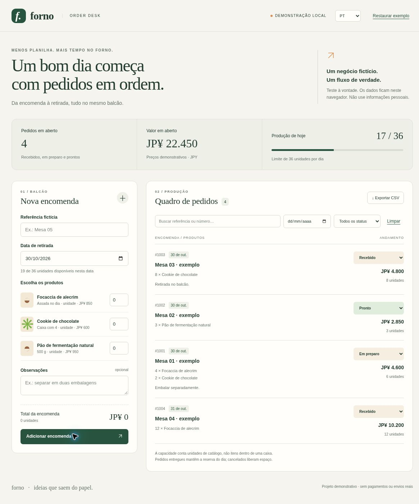

# Forno · Order Desk

Um pequeno sistema de encomendas para um negócio **fictício** de panificação. Projeto demonstrativo de portfólio: transforma pedidos dispersos em um fluxo operacional com validações reais, sem fingir ser um cliente ou produto comercial em produção.

## O problema → a solução

Uma lista de pedidos não mostra se ainda cabe mais produção no dia. O Forno une catálogo, cálculo de preço e reserva de capacidade: **36 unidades de catálogo por data**. O quadro acompanha a encomenda de recebida a entregue, e permite cancelar sem perder o histórico.

## Experimente em 2 minutos

1. Veja os quatro pedidos fictícios iniciais.
2. Crie uma encomenda com 2 focaccias e 3 caixas de cookies: total **¥3.500**.
3. Tente reservar mais unidades do que restam no dia; o formulário explica o limite.
4. Mude o status, filtre pela referência e exporte os resultados para CSV.
5. Recarregue: pedidos e idioma continuam salvos. Use “Restaurar exemplo” para recomeçar, com confirmação e opção de cancelar.

**Idiomas:** português, inglês e japonês. A seleção é persistida; rótulos, mensagens, catálogo, datas exibidas, moeda e cabeçalhos do CSV são localizados. Campos livres do usuário não são traduzidos. O seletor nativo de data segue o idioma do navegador. Trocar o idioma preserva o formulário ainda não enviado e os filtros. Se o armazenamento estiver indisponível, a troca funciona nesta sessão e exibe um aviso.

## Executar

Pré-requisito: Node.js 20+ para os testes/build; Python 3 apenas para o servidor simples abaixo. Nenhuma dependência de runtime ou instalação npm é necessária.

```sh
npm run check
npm run build
python3 -m http.server 8080 --directory dist
# abrir http://localhost:8080
```

## Recursos

- Catálogo com quantidades inteiras, data e observação opcional.
- Valores JPY em inteiros: sem arredondamento monetário intermediário.
- Limite diário; cancelamento libera capacidade e reativação valida novamente.
- Pedidos entregues continuam ocupando a capacidade da data original.
- Busca por referência/número, filtro por data e por status; exportação do recorte visível.
- Persistência versionada, validação dos dados lidos e aviso em falha de armazenamento.
- CSV com BOM UTF-8, aspas escapadas e neutralização de prefixos de fórmula.
- Elementos semânticos, labels, foco visível, diálogo nativo e mensagens de estado acessíveis.
- Interface responsiva, sem fontes, imagens ou scripts externos.

## Arquitetura

```text
index.html           Estrutura semântica
src/domain.js        Funções puras: validação, capacidade, preço, filtros e CSV
src/app.js           DOM, eventos e armazenamento local
src/i18n.js          Dicionário PT → EN/JA e formatação das mensagens
src/styles.css       Sistema visual e breakpoints
scripts/build.js     Cópia determinística dos arquivos públicos para dist/
tests/*.test.js      Regras de domínio e integridade da localização
```

Sem framework para manter a solução pequena e auditável. O domínio não depende do DOM: isso permite testar regras de negócio isoladamente. Dados são inseridos com `textContent`, não HTML interpolado.

## Verificação

`npm run check` executa verificação de sintaxe e testes automatizados de domínio/localização. Veja [docs/QA.md](docs/QA.md) para o que foi executado no navegador e as limitações. [tests/ui.cua.js](tests/ui.cua.js) contém o roteiro automatizável para o browser CUA; ele não faz parte do runner Node.

## Limites conscientes

- É uma demonstração local, não um serviço de gestão pronto para operação comercial.
- Sem login, backend, múltiplos usuários, sincronização entre abas/dispositivos, pagamentos, estoque de insumos, impostos, envio de mensagens ou integração real.
- Não insira dados pessoais. Limpar o armazenamento do navegador remove os testes. CSV é exportação, não um backup reimportável.
- Não há edição de pedidos após criação; cancele e crie outro. Status pode ser alterado livremente (com checagem de capacidade ao reativar).
- Preços e capacidade são fictícios/fixos. Uma caixa de cookies equivale a uma unidade de catálogo, independentemente dos quatro cookies internos.
- Data é local ao navegador. Não há agendamento automático ou atualização à meia-noite sem nova interação/reload.
- Não há garantia de segurança de planilhas que removam a proteção contra fórmula ao reabrir/salvar arquivos.

## English

**Forno** is a fictional bakery order-management portfolio demo. Create orders, calculate whole-yen totals, enforce daily capacity, move orders through statuses, filter and export CSV. All data stays in the browser. No real customer, payment, account or production-system claim is implied. Run `npm run check`, `npm run build`, then serve `dist/`. Choose EN in the language menu.

## 日本語

**Forno** は、架空のベーカリーを題材にしたポートフォリオ用の注文管理デモです。注文登録、日本円の合計計算、日別の生産枠チェック、状態変更、絞り込み、CSV出力を試せます。データはブラウザ内に保存されます。実際のお客様のシステムではなく、決済・アカウント・外部連携はありません。個人情報は入力しないでください。`npm run check`、`npm run build` を実行し、`dist/` をHTTPサーバーで公開して開きます。言語メニューで「日本語」を選択できます。

## Captura de tela / Screenshot / 画面


